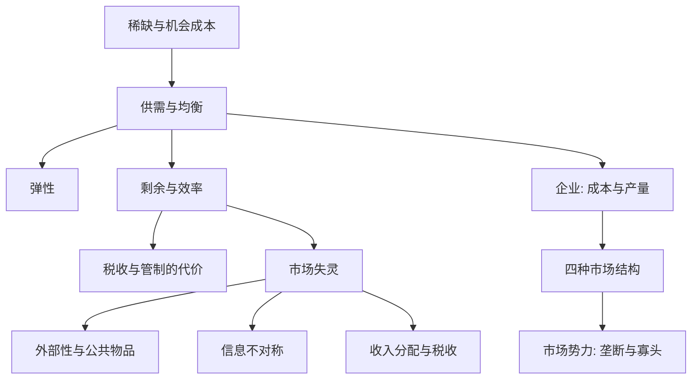

# 曼昆《经济学原理（第 7 版）》微观分册 点化学习系统

## 这本分册在讲什么
微观经济学回答一个问题：**资源有限、欲望无限时，人们怎么配置资源，结果好不好**。曼昆的写法是从"十大原理"出发，先建立供需与效率的框架，再逐个放松假设——加入外部性、市场势力、信息不对称——看市场在哪里失灵、该怎么修补。

主线可以压成一句：价格是协调千万人的信号；当价格能完整反映成本与收益时，它带来效率；当它反映不了（外部性、垄断、公共物品、信息不对称），就需要制度。

## 全书心智模型

看图说明：左上是全书的地基（稀缺与机会成本），中间是主体（供需、剩余、企业行为），右边是三次"放松假设"带来的修补。学完之后，你能沿着这张图指出任一概念的位置。

## 学习路径（推荐顺序）

| 步骤 | 章节 | 主题 | 前置 | 检查点 |
|---|---|---|---|---|
| 01 | ch01–ch03 | 地基：十大原理、经济学家思维、贸易 | 无 | 通过三章自测，能算出机会成本与比较优势 |
| 02 | ch04–ch06 | 供需、弹性、政府政策 | 01 | 能画均衡、判断价格管制后果 |
| 03 | ch07–ch09 | 剩余、赋税、国际贸易 | 02 | 能算消费者/生产者剩余与无谓损失 |
| 04 | ch10–ch12 | 外部性、公共物品、税制 | 03 | 能判断市场失灵类型并选工具 |
| 05 | ch13–ch17 | 成本、竞争、垄断、垄断竞争、寡头 | 02 | 能用 MR = MC 分析四种结构 |
| 06 | ch18–ch20 | 要素市场、收入与歧视、不平等 | 05 | 能算边际产量值、解释工资差距 |
| 07 | ch21–ch22 | 消费者选择、前沿议题 | 05 | 能用无差异曲线求最优、区分逆向选择与道德风险 |

## 章节索引
- 第 1 章 十大原理（★☆☆）→ chapters/ch01-十大原理.md
- 第 2 章 像经济学家一样思考（★☆☆）→ chapters/ch02-像经济学家一样思考.md
- 第 3 章 相互依存性与贸易（★☆☆）→ chapters/ch03-相互依存性与贸易.md
- 第 4 章 供给与需求的市场力量（★★☆）→ chapters/ch04-供给与需求的市场力量.md
- 第 5 章 弹性及其应用（★★☆）→ chapters/ch05-弹性及其应用.md
- 第 6 章 供给、需求与政府政策（★★☆）→ chapters/ch06-供给需求与政府政策.md
- 第 7 章 消费者、生产者与市场效率（★★☆）→ chapters/ch07-消费者生产者与市场效率.md
- 第 8 章 赋税的代价（★★★）→ chapters/ch08-赋税的代价.md
- 第 9 章 应用：国际贸易（★★☆）→ chapters/ch09-应用国际贸易.md
- 第 10 章 外部性（★★☆）→ chapters/ch10-外部性.md
- 第 11 章 公共物品和公共资源（★★☆）→ chapters/ch11-公共物品和公共资源.md
- 第 12 章 税制的设计（★★☆）→ chapters/ch12-税制的设计.md
- 第 13 章 生产成本（★★★）→ chapters/ch13-生产成本.md
- 第 14 章 竞争市场上的企业（★★★）→ chapters/ch14-竞争市场上的企业.md
- 第 15 章 垄断（★★★）→ chapters/ch15-垄断.md
- 第 16 章 垄断竞争（★★★）→ chapters/ch16-垄断竞争.md
- 第 17 章 寡头（★★★）→ chapters/ch17-寡头.md
- 第 18 章 生产要素市场（★★★）→ chapters/ch18-生产要素市场.md
- 第 19 章 收入与歧视（★★★）→ chapters/ch19-收入与歧视.md
- 第 20 章 收入不平等与贫困（★★★）→ chapters/ch20-收入不平等与贫困.md
- 第 21 章 消费者选择理论（★★★）→ chapters/ch21-消费者选择理论.md
- 第 22 章 微观经济学前沿（★★★）→ chapters/ch22-微观经济学前沿.md

## 前置知识（理工科本科缺口补讲）
| 缺口 | 对应补讲位置 | 学完标志 |
|---|---|---|
| 机会成本的概念（工科习惯算"实际花的钱"） | ch01、ch13 的零基础讲解 | 能算出含隐性成本的经济利润 |
| 边际思维（习惯看总量与平均） | ch05、ch13 的"边际拉动平均" | 能解释 MC 为什么穿过 ATC 最低点 |
| 弹性与百分比的比较 | ch05 | 能用中点法算弹性并判断收益方向 |
| 无差异曲线与斜率的经济含义 | ch21 | 能写出 MRS = Px/Py 并说明它的意思 |
| 概率与期望值（用于外部性与风险） | ch10、ch22 | 能把期望损失与保险费比较 |

## 术语表 / 模式库 / 速查表入口
- 术语：glossary.md（全 22 章术语，按章排列）
- 模式：patterns.md（五个分析框架 + 决策规则 + 反模式）
- 速查：cheatsheet.md（公式、统一定量示例、判断流程）
- 概念页：concepts/（机会成本、供需、弹性、剩余与效率、外部性与公共物品、市场结构）
- 测验：quiz.md；抽认卡：flashcards.md
