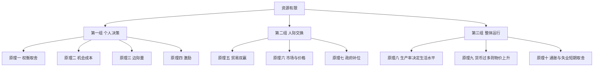

# 第 1 章：经济学十大原理

- **难度**：★☆☆ | **预估学时**：1.5 小时 | **前置**：无

## 学习目标
学完本章，你能：
1. 不看笔记说出十大原理，并把每条归入「个人怎么决策 / 人与人怎么打交道 / 整体经济怎么跑」三组中的一组。
2. 用机会成本这个概念，把一个具体选择（比如读不读研）的代价算成一个数。
3. 判断一个说法是靠「边际」成立的还是靠「平均」成立的，并指出混用两者会错在哪里。

## 一句话核心
资源不够分，所以任何选择都有代价；价格和激励把千万人的选择连成一张网；这张网的总体产出取决于生产率，而它的短期波动被货币和总需求牵着走。

## 零基础讲解

### 经济学管的是什么
经济学研究一件很朴素的事：**资源有限，欲望不那么有限，怎么办**。曼昆把这套办法压成十条原理，分成三组。你先把三组记住，再记十条——十条是散的，三组是有结构的。

### 第一组：个人怎么决策（原理一至四）

**原理一：人们面临权衡取舍。**
要得到一样东西，通常得放弃另一样。这不是道德劝告，是算术：一天 24 小时，学习多一小时，睡觉、打球、刷手机就少一小时。**权衡取舍**（trade-off）就是"多要 A 就必须少要 B"这种此消彼长的关系。

一个常见的误读是把"权衡取舍"当成"两样都不好"。恰恰相反，取舍经常发生在两个都想要的东西之间，这才是它让人难受的原因。

**原理二：某种东西的成本，是为了得到它所放弃的东西。**
这句话定义了一个核心概念：**机会成本**（opportunity cost）。它不是"花了多少钱"，而是"因为这些钱和时间，你没能做的另一件事值多少"。

算一个具体的账。假设你读四年大学：学费每年 3 万元，书本住宿每年 2 万元，不读大学去工作每年能挣 6 万元。那么读大学的总机会成本是 (3+2+6)×4 = 44 万元。账面支出只有 20 万元，剩下 24 万元是你没挣到的工资。这就是为什么"上大学贵不贵"这个问题不能只看缴费单。

机会成本里还藏着一个容易漏掉的项：**你已经在里面投进去、收不回来的钱**，做决策时不应该再算进去。第 14 章会把它命名为**沉没成本**，那里再说。

**原理三：理性人考虑边际量。**
**边际**（marginal）指"再多一单位"带来的变化。边际量 = 多一单位带来的额外收益或额外成本。理性人比较的是边际收益和边际成本，不是总量，也不是平均量。

飞机例子最清楚。一架 200 座的飞机已经卖出 190 张票，起飞前还剩 10 个空座。多载一位乘客的**边际成本**几乎只有一份餐食和一点燃油，比如 30 元；只要有人愿意出超过 30 元的票价，让他上飞机就是赚的——哪怕这个价格远低于 500 元的平均票价。总量思维会算"平均每座成本 500 元，卖 100 元亏了"，从而拒绝这笔实际上赚钱的交易。

**原理四：人们会对激励做出反应。**
**激励**（incentive）是让人改变行为的东西：奖励、惩罚、价格、规则都算。汽油从 7 元涨到 9 元一升，通勤 50 公里的人每月油钱从约 700 元涨到 900 元，一部分人就会改坐地铁、换小排量车、或者搬家。价格变了，行为跟着变，这就是激励在起作用。

这条原理的杀伤力在于它管的是**间接后果**。政策改变一个激励，人会绕开它、适应它，结果常常不是设计者想要的。第 6 章的价格管制、第 12 章的税制设计，都在反复演示这一点。

### 第二组：人与人怎么打交道（原理五至七）

**原理五：贸易可以使每个人的状况都变得更好。**
贸易不是零和。两个人（或两个国家）各做自己相对更擅长的事，再交换，双方的总产出都变多。注意"相对更擅长"这四个字——不是绝对水平高才有得赚，第 3 章的**比较优势**会把这件事讲透。

**原理六：市场通常是组织经济活动的一种好方法。**
**市场**是买卖双方自发交换的场所与规则。它的核心机制是**价格**：价格高说明东西稀缺，生产者多生产、消费者少用；价格低反过来。没有人下命令，几亿人的生产和消费靠价格对上号。曼昆在这里引了亚当·斯密的说法：价格的这种作用像一只"看不见的手"。

**原理七：政府有时可以改善市场结果。**
市场不是万能的，它需要两样东西才能正常工作：**产权**（谁的东西归谁，说清楚）和**竞争**（没人能操纵价格）。产权不清，没人愿意投资；一家独大，价格就由卖方定，市场调节失灵。此外还有**外部性**——你的行为让别人承担了成本或得到了好处，而价格没有把这笔账算进去，比如工厂排污。这些场合政府出手（保护产权、反垄断、征税或补贴）能让结果变好。

### 第三组：整体经济怎么跑（原理八至十）

**原理八：一国的生活水平取决于它生产物品与服务的能力。**
这个能力叫**生产率**（productivity），指平均每个工人每小时能产出多少东西。生活水平的长期差距，几乎全部来自生产率差距，而不是来自谁更会分配。想让人均收入长期涨，只能让每小时产出涨。

**原理九：当政府发行了过多货币时，物价上升。**
物价普遍上涨叫**通货膨胀**。长期看，通胀的根源是货币量增长过快：流通中的钱多了，而货架上的东西没同比例变多，单位物品就要更多钱来换。这是第 30 章的主题。

**原理十：社会面临通货膨胀与失业之间的短期权衡取舍。**
短期内，政府多印钱、多花钱能把需求拉起来，企业多招人，失业下降，代价是通胀上升；反过来压通胀，短期失业会上升。这条取舍关系是第 35 章**菲利普斯曲线**的起点。注意"短期"三个字：长期里这条取舍不成立。

## 图示

看图说明：十条原理不是并列的清单。上面一个共同起点（资源有限），下面按"看一个人 / 看两个人以上 / 看整个国家"分三层。考试里问"这条属于哪一组"，靠的就是这张图的分层。

## 类比与实例

**类比：自助餐。**
自助餐一次付清、随便吃，看起来"多吃才回本"，但每多拿一盘，你付出的是胃的空间和吃撑的难受——这就是边际成本随份数上升。吃到第七盘时边际收益已经接近零，理性的人会停。这个类比的失效边界：自助餐的边际成本是身体感受，而真实市场里边际成本是钱和资源，有些商品的边际成本几乎为零（比如一份软件的复制），那时定价逻辑完全不同。

**实例：一份决策的四栏账。**
小林考虑换工作。新工作月薪多 2000 元，但通勤每天多 1 小时、单程车费多 6 元。按每月 22 个工作日算：
- 边际收益：2000 元/月
- 边际成本：车费 6×2×22 = 264 元/月；时间 22 小时/月，若他给自己的闲暇定价 30 元/小时，则 660 元/月
- 合计边际成本：924 元/月
- 净收益：2000 − 924 = 1076 元/月

结论是换。若他给时间定价 80 元/小时（比如他在做副业），时间成本变 1760 元，净收益只剩 2000−264−1760 = −24 元，结论翻转。同一份工作，因为你给时间定的价不同而结论不同——这正是机会成本在起作用。

## 常见误解
- 别以为"成本就是花出去的钱"——实际上成本还包括你因此放弃的收益，也就是机会成本。同一笔学费，对一个能拿到年薪 20 万工作的人，比对一个月薪 4000 的人，贵得多。
- 别以为"平均成本低就划算"——实际上决策看边际。平均成本包含已经发生、收不回来的支出，它对"要不要再多做一单"这个问题没有指导意义。
- 别以为市场机制等于"政府什么都别管"——实际上原理六和原理七是一对：市场在产权清楚、竞争充分时有效，缺这两个条件时政府介入能改善结果。曼昆既不主张无政府，也不主张全能政府，他要的是分清哪种场合用哪种。
- 别以为通胀是"东西变贵了"这么简单——实际上要区分"某样东西涨价"（相对价格变化）和"物价普遍上涨"（通胀）。前者靠供求，后者长期靠货币量。

1. （单选）某人辞去年薪 12 万元的工作去读两年全日制硕士，每年学费与书本费合计 5 万元。他读硕士的机会成本约为多少？
   A. 10 万元  B. 12 万元  C. 22 万元  D. 34 万元
   **答案**：D；**解析**：机会成本 = 账面支出 5×2 = 10 万元 + 放弃的工资 12×2 = 24 万元，合计 34 万元。只加学费得到 10 万元是账面成本，漏掉了放弃的收入。

2. （单选）一家影院平时票价 40 元，工作日上午几乎空场。经营者决定加开一场早场，票价 15 元。这个决定是否理性，取决于什么？
   A. 15 元是否高于每张票的平均总成本  B. 15 元是否高于加开一场的边际成本  C. 15 元是否高于 40 元的一半  D. 早场观众是否会在下午再买一张票
   **答案**：B；**解析**：上午场地和设备已经闲置，加开一场的边际成本只有少量人工与电费。只要票价高于边际成本，这笔生意就增加利润；平均成本包含已发生的固定支出，不适用于这个判断。

3. （多选）下列哪些属于曼昆所说「政府有时可以改善市场结果」的场合？
   A. 产权界定不清，偷盗与违约频发  B. 某行业由一家企业垄断并自行定价  C. 工厂排污让下游居民承担成本  D. 消费者偏好进口商品而非国产商品
   **答案**：A、B、C；**解析**：前三项分别是产权缺失、市场势力、外部性，都是市场自身无法纠正的失灵。消费者偏好进口货只是偏好，价格机制能正常处理，不需要政府介入。

4. （填空）「一国生活水平的长期水平取决于它生产物品与服务的能力」，这个能力在书里叫什么？（两字词）
   **答案**：生产率；**解析**：生产率指平均每个工人每小时产出的物品与服务量。长期看，人均收入的差距几乎完全由生产率差距解释。

## 复习锚点
- 三组十原理：个人决策（取舍、机会成本、边际、激励）、人际交换（贸易、市场、政府）、整体运行（生产率、货币、短期取舍）。
- 机会成本 = 账面支出 + 放弃的收益；沉没成本不进决策。
- 决策比较的是边际收益与边际成本，不是平均值。
