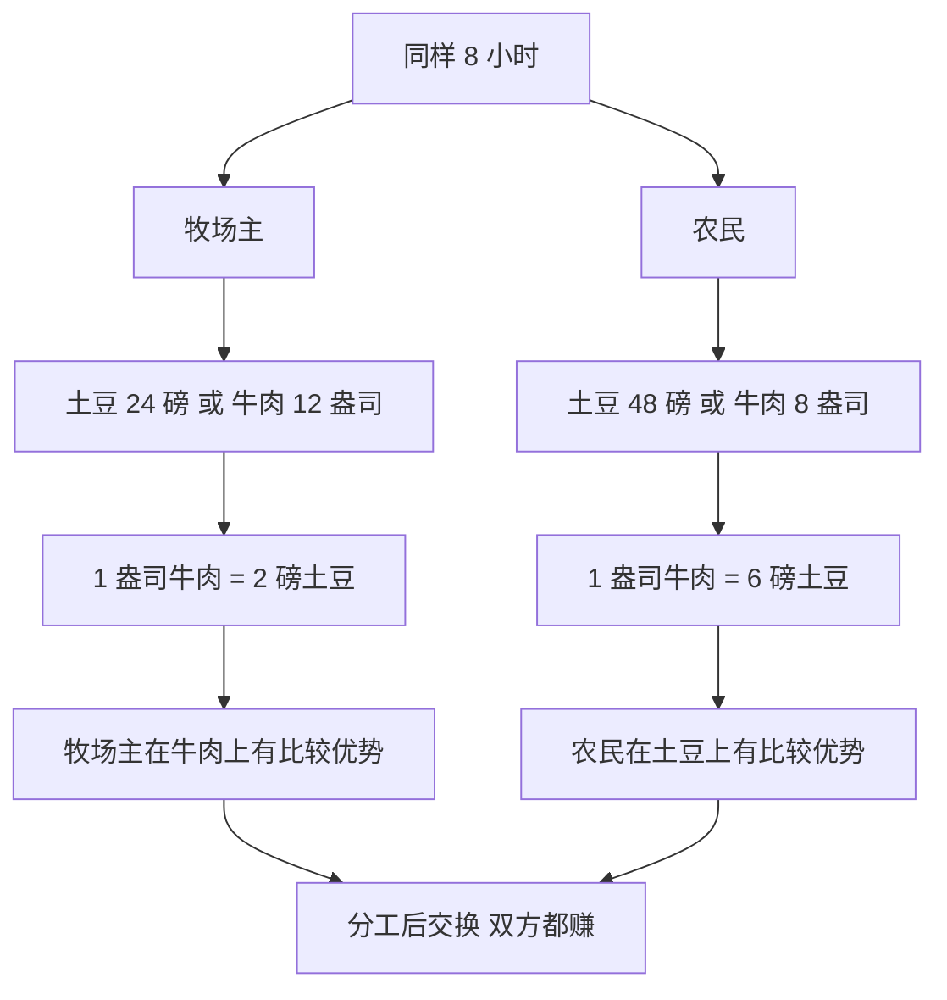

# 第 3 章：相互依存性与贸易的好处

- **难度**：★★☆ | **预估学时**：1.5 小时 | **前置**：第 1 章（机会成本）

## 学习目标
学完本章，你能：
1. 用「机会成本」算出两个生产者的比较优势分别在哪一项。
2. 分清绝对优势与比较优势，并解释为什么只有比较优势才决定该不该分工。
3. 给出一组具体的交换比例，算出双方各自从贸易中得到的净收益。

## 一句话核心
分工的标准不是「谁做得更好」，而是「谁为此放弃得更少」——比较优势决定谁该做什么，贸易让双方用各自放弃更少的东西换到对方放弃更多的东西。

## 零基础讲解

### 一个现代寓言
书里用一个农民和一个牧场主开场。

- 牧场主：8 小时能产 24 磅土豆，或者 12 盎司牛肉。
- 农民：8 小时能产 48 磅土豆，或者 8 盎司牛肉。

两个人都要吃饭，都要吃土豆和牛肉。问题是：各干各的然后交换，还是各干各的但都自己种土豆、自己养牛？

先算**机会成本**（为了得到一单位某物而放弃的另一物的数量）：

- 牧场主每产出 1 盎司牛肉，放弃 24/12 = 2 磅土豆。
- 农民每产出 1 盎司牛肉，放弃 48/8 = 6 磅土豆。

也就是说，同样 1 盎司牛肉，牧场主只花 2 磅土豆的代价，农民要花 6 磅。反过来看土豆：牧场主 1 磅土豆的代价是 1/2 盎司牛肉，农民是 1/6 盎司。农民做土豆便宜，牧场主做牛肉便宜。

### 绝对优势与比较优势
**绝对优势**（absolute advantage）：用同样的投入，谁产出的更多。这里看 8 小时：牧场主土豆 24 磅 < 农民 48 磅，牛肉 12 盎司 > 农民 8 盎司。牧场主在牛肉上有绝对优势，农民在土豆上有绝对优势。

**比较优势**（comparative advantage）：谁生产某物的机会成本更低。牧场主牛肉的机会成本 2 磅土豆 < 农民 6 磅，所以牧场主在牛肉上有比较优势；农民土豆的机会成本 1/6 盎司牛肉 < 牧场主 1/2 盎司，所以农民在土豆上有比较优势。

这里两者恰好一致，看起来没必要区分。但有大量情形两者会分开，一旦分开，**决定分工的是比较优势，不是绝对优势**。书上用运动员的例子把这一点钉住：一位顶级运动员修剪自家草坪比邻居快得多（有绝对优势），但他每小时的出场收入远高于邻居，所以修剪草坪的机会成本极高，他该做的是雇邻居来剪，自己去打球。

### 贸易怎么让双方都赚
接着上面的例子，假设交换比例是 3 盎司牛肉换 9 磅土豆。

牧场主的角度：他拿到 9 磅土豆，为此付出 3 盎司牛肉。而 3 盎司牛肉在他手里只值 3×2 = 6 磅土豆。用 6 磅土豆的代价换到 9 磅土豆，净赚 3 磅土豆。

农民的角度：他拿到 3 盎司牛肉，为此付出 9 磅土豆。而 3 盎司牛肉若自己生产要花 3×6 = 18 磅土豆。用 9 磅土豆换到值 18 磅的东西，净赚相当于 9 磅土豆。

两边都赚，因为各自都在做自己机会成本低的那件事。这就是"贸易不是零和"的算术版本——不是谁占了谁便宜，而是分工本身让总产出变多。

### 交换比例落在哪
谈判的区间由双方的机会成本夹住：1 盎司牛肉的价格必须在 2 磅到 6 磅土豆之间。低于 2 磅，牧场主不干（不如自己种土豆）；高于 6 磅，农民不买（不如自己养牛）。具体落在区间哪一点，取决于谈判能力，但双方都有得赚这一点不依赖谈判能力。

### 从两个人到两个国家
同一个逻辑适用于国家。**世界价格**和国内价格的差异决定一国该出口还是进口。这一章只搭框架，第 9 章会把关税、赢家输家、以及"为什么贸易政策常常走向保护主义"讲完。

## 图示

看图说明：图里没有出现"谁更强"。判断依据一路沿到最后的都是"机会成本"那一列数字。这就是比较优势的算法本质：只看放弃的量，不看产出的绝对大小。

## 类比与实例

**类比：两个同事换班。**
A 换一个夜班要放弃两小时睡眠，B 换一个夜班要放弃四小时睡眠。那么夜班该由 A 多承担，白班该由 B 多承担，两人换班后总睡眠损失最小。类比的失效边界：同事换班可以靠"总损失最小"直接判断，因为两人的偏好是私人的；国家间的比较优势会随资源、技术变化而改变，不是固定属性。

**实例：两个小工厂。**
甲厂一天能产 200 个零件或 50 个组件；乙厂一天能产 100 个零件或 50 个组件。甲厂在零件上有绝对优势（200 > 100），组件上两者持平。机会成本：甲厂 1 个组件 = 4 个零件，乙厂 1 个组件 = 2 个零件。乙厂在组件上有比较优势。所以甲厂做零件、乙厂做组件，再按"1 个组件换 3 个零件"交换：乙厂用 2 个零件的代价换到 3 个，赚 1 个；甲厂用 3 个零件的代价换到值 4 个零件的组件，也赚 1 个。

## 常见误解
- 别以为"我样样都比你强，就不需要跟你贸易"——实际上决定分工的是比较优势。强者在每项上都有绝对优势时，仍然应该把机会成本最高的那项交出去。
- 别以为贸易是"一方赢一方输"——实际上自愿交换的双方都得到净收益，否则交易不会发生。真正的问题是有第三方受损（比如进口竞争行业的工人），这属于分配问题，不是贸易本身不创造价值。
- 别以为比较优势是"天生擅长"——实际上它由机会成本决定，而机会成本由资源和技术决定。资源变了，比较优势就会变。

1. （单选）甲 1 小时能产 10 件衣服或 5 台电视，乙 1 小时能产 8 件衣服或 2 台电视。谁在电视上有比较优势？
   A. 甲，因为他单位时间产量更高  B. 乙，因为他放弃的衣服更少  C. 甲，因为 1 台电视只放弃 2 件衣服  D. 两人都没有
   **答案**：C；**解析**：机会成本：甲 1 台电视 = 2 件衣服，乙 1 台电视 = 4 件衣服。甲的机会成本更低，所以甲在电视上有比较优势。顺带可见甲在衣服上也有绝对优势，但乙在衣服上的机会成本是 0.25 台电视，仍低于甲的 0.5 台，所以乙在衣服上有比较优势。

2. （单选）某顶级外科医生做手术的收费是每小时 3000 元，他打扫自己家的效率也比保洁员高一倍。按比较优势，他应该？
   A. 自己打扫，因为他效率更高  B. 请保洁员，因为他打扫的机会成本远高于保洁费  C. 自己打扫，因为请人还要花时间沟通  D. 两人都不打扫，等家人来收拾
   **答案**：B；**解析**：效率高只是绝对优势。他打扫一小时放弃的是 3000 元收入，机会成本远高于保洁费，所以应由机会成本更低的人做。绝对优势在这里完全不影响结论。

3. （填空）牧场主 1 盎司牛肉的机会成本是 2 磅土豆，农民是 6 磅土豆。两人交换牛肉时，1 盎司牛肉的土豆价格必须落在什么区间内才可能成交？
   **答案**：2 到 6 磅之间；**解析**：低于 2 磅牧场主宁可自己种土豆，高于 6 磅农民宁可自己养牛。区间之内双方都能从交换中获益，具体落在哪一点取决于谈判。

## 复习锚点
- 比较优势看机会成本，绝对优势看同等投入下的产出量。
- 分工按比较优势来，贸易的谈判区间夹在双方的机会成本之间。
- 自愿交换双方都赚，赚的是"用自己放弃更少的东西换到对方放弃更多的东西"。
