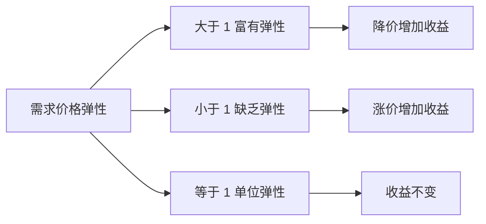

# 弹性

- **难度**：进阶 | **涉及章节**：第 5、6、8、12 章

## 一句话定义
弹性衡量"一个变量变动 1%，另一个变量会变动百分之几"；价格弹性大，说明消费者对价格很敏感，一涨价就跑。

## 为什么重要
弹性决定了价格变动对收益、对税负分摊、对政策效果的影响。同样是加税，对香烟（弹性小）和对奶茶（弹性大）的结果完全不同。

## 图示

看图说明：这张图给出最实用的推论——涨价能不能多赚钱，只看弹性。弹性小于 1 时涨价增收；大于 1 时涨价反而减收。

## 详解
### 算法
**需求价格弹性** = 需求量变化百分比 ÷ 价格变化百分比。

例：价格从 20 涨到 22（+10%），需求量从 20 降到 18（−10%），弹性 = 10% ÷ 10% = 1。

用中点法可以避免"起点不同、结果不同"的问题：分母用平均值。

### 影响因素
- **替代品多不多**：替代品多则弹性大（可乐涨价，改喝雪碧）。
- **是不是必需品**：必需品的弹性小（药、盐）。
- **支出占比**：占比大则弹性大。
- **调整时间**：时间越长弹性越大（油价涨了，短期照开，长期换车或搬家）。

### 其他弹性
- **供给弹性**：价格变动引起供给量变化的敏感度，取决于产能调整的难易。
- **交叉价格弹性**：一种商品价格变动引起另一种商品需求变动的幅度。正值是替代品，负值是互补品。
- **收入弹性**：收入变动引起需求变动的幅度。大于 1 是奢侈品，小于 1 是必需品，负值是劣等品。

### 三个应用
1. **收益判断**：弹性小于 1，涨价增收；大于 1，降价增收。
2. **税负分摊**（第 8 章）：弹性小的一方承担更多税负。香烟税主要由消费者承担，因为烟民难以戒断。
3. **政策效果**（第 6 章）：最低工资对就业的伤害取决于劳动需求弹性；弹性小则伤害小。

## 常见误解
- 别以为"弹性大就是需求量大"——实际上弹性衡量的是敏感度，与绝对数量无关。
- 别以为"必需品永远缺乏弹性"——实际上长期看弹性会变大（人们会找到替代方案）。
- 别以为"涨价一定增收"——实际上弹性大于 1 时涨价会减少总收入。

## 在书中出现的脉络
| 章节 | 语境 | 关键结论 |
|---|---|---|
| 第 5 章 | 弹性及其应用 | 四类弹性的算法与用途 |
| 第 6 章 | 价格控制 | 短缺程度取决于供需弹性 |
| 第 8 章 | 赋税的代价 | 税负分摊与无谓损失都由弹性决定 |
| 第 12 章 | 税制设计 | 对什么征税、税负落在谁身上 |

## 相关概念
- **供给与需求**（弹性的几何含义是曲线陡缓）
- **剩余与效率**（税收的无谓损失随弹性增大而增大）
- **税收归宿**（弹性小者多担税）
