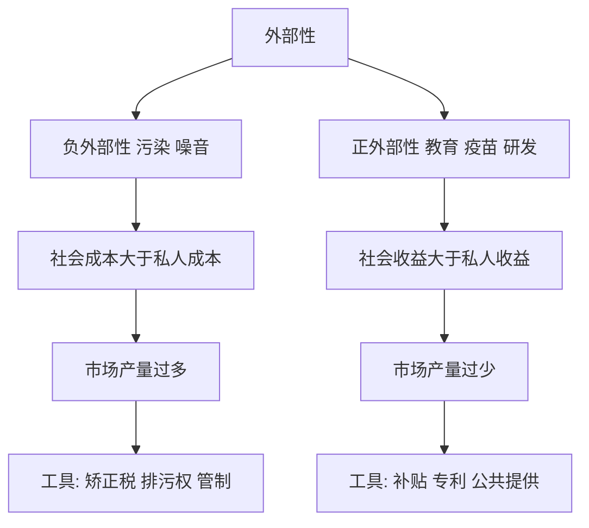

# 外部性与公共物品

- **难度**：进阶 | **涉及章节**：第 10、11、12 章

## 一句话定义
外部性是"你的行为让别人承担了成本或获得了收益，但价格里没体现"；公共物品是"人人都能用、也没人能不让别人用"的东西。两者都会让市场自己算错账。

## 为什么重要
前面几章的"市场有效率"有一个隐含前提：交易的成本与收益都落在交易双方身上。这条前提一破，价格信号就失真——污染没人买单、灯塔没人建、疫苗没人打够。

## 图示

看图说明：两条分支的结论相反——一个产量过多、一个过少，但病因相同：价格没把第三方的得失算进去。工具也就分两类：对负外部性加成本，对正外部性补收益。

## 详解
### 负外部性
工厂排污，社会成本 = 私人成本 + 污染代价。市场价格只反映私人成本，于是产量多于社会最优。

数字例子：需求 P = 30 − 0.5Q，私人成本 MC = 10 + Q，每单位污染的社会代价 4 元。
- 私人均衡：30 − 0.5Q = 10 + Q → Q ≈ 13.3。
- 社会最优：30 − 0.5Q = 14 + Q → Q ≈ 10.7。

社会最优产量低于私人产量，差额就是过度生产。

### 正外部性
教育让整个社会受益（更低犯罪率、更高生产率），但受教育者只按自己的收益付费，于是教育投入少于社会最优。工具是补贴或公共提供。

### 公共物品的两个特征
- **非排他性**：无法阻止别人使用（国防、路灯）。
- **非竞争性**：一个人用不影响别人用。

两者兼具就是**公共物品**。只有非排他性、但用的人多了会拥挤的，叫**公共资源**（渔场、牧场、公路）。

**搭便车**（free rider）：既然不付钱也能用，就没人愿意付钱。结果是公共物品供给不足。

**公地悲剧**（tragedy of the commons）：公共资源被过度使用，因为使用成本由全体分担、收益归自己。渔场过度捕捞、牧场过度放牧都是。

### 工具与取舍
- **矫正税（庇古税）**：按外部成本征税，把外部性内部化。优点是给企业减排的灵活性（谁减排便宜谁多减）；缺点是税率难以精确设定。
- **可交易的污染许可证**：政府定总量、发许可证、允许交易。总量可控，减排由最便宜的企业完成。
- **管制**：直接规定排放标准。简单，但一刀切，成本高。
- **科斯定理**：若产权清晰、交易成本低，双方可以自行谈判解决，无需政府。现实中交易成本常很高（受害者众多）。

## 常见误解
- 别以为"外部性只能靠政府解决"——实际上产权明确时当事人可以谈判；许可证交易也是市场手段。
- 别以为"公共物品应该全部由政府提供"——实际上有些可由私人提供（收费公路），关键是排他性是否可行。
- 别以为"污染税只是收钱"——实际上它改变行为，把外部成本变成企业的决策成本。

## 在书中出现的脉络
| 章节 | 语境 | 关键结论 |
|---|---|---|
| 第 10 章 | 外部性 | 社会成本曲线、矫正税、排污权交易、科斯定理 |
| 第 11 章 | 公共物品与公共资源 | 搭便车、公地悲剧、成本收益分析的困难 |
| 第 12 章 | 税制设计 | 用税收纠正外部性同时为公共支出筹资 |
| 第 22 章 | 微观前沿 | 信息不对称也是市场失灵的一种 |

## 相关概念
- **剩余与效率**（外部性使总剩余无法最大）
- **供给与需求**（社会成本曲线是私人成本曲线的上移）
- **公共物品**（非排他导致无法收费）
