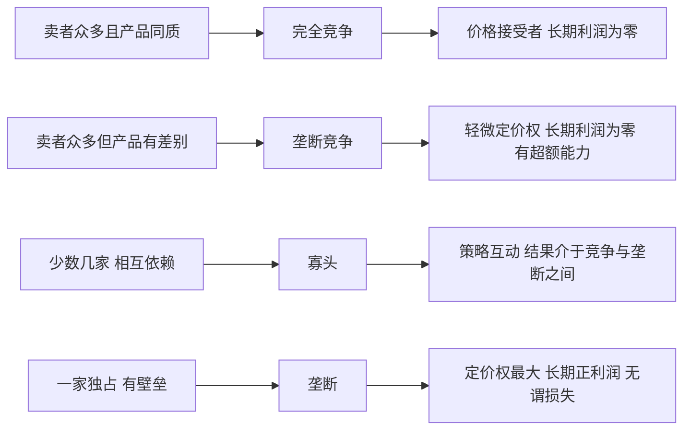

# 市场结构谱系：从完全竞争到垄断

- **难度**：进阶 | **涉及章节**：第 14、15、16、17 章

## 一句话定义
四种市场结构（完全竞争、垄断竞争、寡头、垄断）的差别只有两个变量：**卖者数量**与**产品是否有差别**；这两个变量决定了需求曲线有多平、企业有多大的定价权。

## 为什么重要
这是微观后半部分的骨架。理解了"需求曲线越平、定价权越小"，四种结构的定价、产量、利润、效率结论几乎可以自动推出来，不必逐个背。

## 图示

看图说明：左边是判定条件，右边是结论。从左上到右下，定价权依次增强，效率依次下降（寡头例外，因为它没有唯一的均衡结论）。

## 详解
### 完全竞争
卖者众多、产品同质、自由进出 → 需求曲线水平 → P = MR = MC → 长期 P = 最低 ATC，利润为零。

### 垄断竞争
产品有差别 → 需求曲线向下倾斜但很平 → 短期按 MR = MC 能赚钱 → 长期进入使需求左移到与 ATC 相切 → 零利润、产量低于效率规模（超额能力）。

### 寡头
少数几家互相盯着 → 没有单一模型 → 合作（卡特尔）接近垄断，竞争（囚徒困境）接近竞争，实际落在中间。

### 垄断
一家独占、有壁垒 → 需求曲线就是市场需求曲线 → MR 低于价格 → 按 MR = MC 定产量、沿需求曲线定价 → 长期正利润与无谓损失。

### 一条共同的底层规则
四种结构都用 **MR = MC** 定产量。差别只在 MR 与价格的关系：
- 完全竞争：MR = P
- 垄断竞争与垄断：MR < P
- 寡头：MR 取决于对手的反应

记住这一条，四章内容就串成了一条线。

## 常见误解
- 别以为"垄断者想定多高价就定多高"——实际上高价会压缩销量，最优点在 MR = MC。
- 别以为"垄断竞争等于垄断"——实际上它没有壁垒，长期利润为零。
- 别以为"寡头会自动合谋"——实际上每家都有背叛动机，合谋不稳定。
- 别以为"竞争越激烈对社会越好"——实际上产品差别带来的多样性有价值，不能只看价格。

## 在书中出现的脉络
| 章节 | 语境 | 关键结论 |
|---|---|---|
| 第 14 章 | 竞争市场 | P = MR = MC，长期零利润 |
| 第 15 章 | 垄断 | MR 低于价格，产量压低，无谓损失 |
| 第 16 章 | 垄断竞争 | 相切均衡、超额能力、广告与品牌 |
| 第 17 章 | 寡头 | 策略互动、囚徒困境、卡特尔瓦解 |
| 第 22 章 | 前沿 | 信息不对称与市场势力的新问题 |

## 相关概念
- **供需均衡**（竞争市场的价格由市场给定）
- **剩余与效率**（垄断的无谓损失来自产量压低）
- **机会成本与边际分析**（MR = MC 是边际规则的应用）
