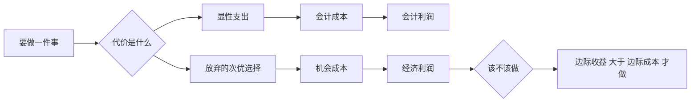

# 机会成本与边际分析

- **难度**：基础 | **涉及章节**：第 1、2、7、13、14 章

## 一句话定义
做一件事的真实代价，是你为此放弃的**次优选择**；而"要不要多做一点"这类问题，看的是**下一单位**的收益与成本，不是总量。

## 为什么重要
这两条是整本微观经济学的底层语法。第 2 章把它们列为"像经济学家一样思考"的核心，后面几乎所有决策——企业定产量、消费者买东西、政府定税率——都是同一套算法的变体。

没有机会成本，就算不出真实利润（第 13 章）；没有边际思维，就会在"平均成本低"的地方错误地扩大生产（第 14 章）。

## 图示

看图说明：左边分叉出两种"成本"，右边汇合成两种"利润"，最后落到一个判断条件上。整张图就是本章两条原则的关系。

## 详解
### 机会成本
你把 10 万元投进一家小店，账面上没付利息，但如果不投这里，这 10 万元本可以买理财赚 4000 元。这 4000 元就是机会成本，它不体现在账本上，但真实存在。

同理，老板自己的时间也是成本。他本可以去打工挣 15 万元，那么"自己看店"这件事的代价就是 15 万元加 4000 元。

所以**经济利润 = 总收益 − 显性成本 − 隐性成本**，而**会计利润只减显性成本**。前者回答"值不值"，后者回答"账面赚没赚"。

类比：一张演唱会门票你免费拿到，去看的代价不是 0，而是"把票转卖能得到的钱 + 那三小时能做的事"。这个类比在"票不能转卖、时间无法替代"时失效。

### 边际分析
边际是"再多一单位"。边际收益（MR）、边际成本（MC）、边际产量、边际税率，都是这个意思。

判断规则很简单：**边际收益 > 边际成本，就多做；小于，就少做；相等，就停在这一点。**

这套规则的威力在于它能处理"总量看起来还赚，但再多做就亏"的情形。一家店已经盈利，但第 7 杯奶茶的成本高于售价，那第 7 杯就不该做——尽管整体仍在赚钱。

### 三个应用
1. **企业定产量**（第 14 章）：P = MC。
2. **消费者买东西**（第 21 章）：边际替代率 = 价格比，即"我愿意换的比例"等于"市场让我换的比例"。
3. **政策定税率**（第 8、12 章）：增税要看边际税率对行为的抑制，不只是平均税负。

## 常见误解
- 别以为"没花钱就没有成本"——实际上放弃的收益就是成本，而且是最容易被忽略的那部分。
- 别以为"总量赚钱就该继续扩大"——实际上要看下一单位的边际账。
- 别以为"沉没成本也该算进去"——实际上已经收不回来的钱不影响"下一步怎么做"。

## 在书中出现的脉络
| 章节 | 语境 | 关键结论 |
|---|---|---|
| 第 1 章 | 十大原理之二、之三 | 决策要看机会成本，理性人看边际 |
| 第 2 章 | 经济学家的思维方式 | 用机会成本与经济利润重算"赚不赚" |
| 第 7 章 | 市场效率 | 剩余是边际买者与边际卖者之间的差额 |
| 第 13 章 | 生产成本 | 经济利润扣隐性成本；MC 决定产量 |
| 第 14 章 | 竞争企业 | 停业判据看 P 与 AVC 的边际比较 |

## 相关概念
- **供给与需求**（价格由边际买卖双方决定）
- **剩余与效率**（剩余的边际解释）
- **市场结构谱系**（不同结构的定价都是 MR = MC 的变体）
