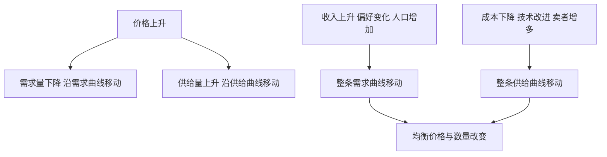

# 供给与需求

- **难度**：基础 | **涉及章节**：第 4、5、6、9、31 章

## 一句话定义
价格是买卖双方在同一张图上"谈"出来的：需求说"这个价我要多少"，供给说"这个价我给多少"，两条线相交处就是均衡价格与均衡数量。

## 为什么重要
它是整个微观经济学的坐标系。弹性、税收、价格管制、国际贸易、甚至宏观的 AD-AS，都是在这张图上加元素。看懂这张图，后面全是图层。

## 图示

看图说明：这张图把"沿曲线移动"与"整条曲线移动"分开。前者由价格引起，后者由价格以外的因素引起。混淆这两件事，是入门最常见的错误。

## 详解
### 两条曲线
**需求曲线**向右下倾斜：价格越低，买得越多。原因有三——更便宜所以更多人买、老买家买更多、替代品被挤走。

**供给曲线**向右上倾斜：价格越高，卖得越多。因为高价能覆盖更高的边际成本。

需求曲线的移动因素：收入、偏好、相关品价格（替代品与互补品）、买者数量、预期。
供给曲线的移动因素：投入成本、技术、卖者数量、预期、政策（税收与补贴）。

### 均衡与调整
均衡价格下，愿意买的量恰好等于愿意卖的量，没有短缺也没有过剩。

若价格高于均衡：卖不掉，库存积压，卖者降价，价格回落。
若价格低于均衡：抢购，短缺，买者抬价，价格回升。

这个过程不需要谁指挥，价格自己就是信号。哈耶克说的"价格是信息"，指的就是这个。

### 三个应用
1. **价格上限**（第 6 章）：房租管制 → 短缺、排队、黑市。
2. **价格下限**（第 6 章）：最低工资 → 过剩的劳动力（失业）。
3. **国际贸易**（第 9 章）：世界价格低于国内均衡价 → 进口；高于 → 出口。

## 常见误解
- 别以为"涨价就是奸商"——实际上若供给没变、需求增加，涨价是均衡的必然结果。
- 别以为"需求增加就是需求量增加"——实际上前者是整条曲线右移，后者是沿曲线移动。
- 别以为"价格管制能让穷人买得起"——实际上上限造成短缺，能买到的人反而更少（要靠排队或关系）。

## 在书中出现的脉络
| 章节 | 语境 | 关键结论 |
|---|---|---|
| 第 4 章 | 市场力量 | 均衡的形成与三条移动规律 |
| 第 5 章 | 弹性 | 曲线陡缓决定涨价的幅度与收益 |
| 第 6 章 | 政府政策 | 价格上下限制造短缺与过剩 |
| 第 9 章 | 国际贸易 | 世界价格与国内均衡价的比较决定进出口 |
| 第 31 章 | 汇率 | 外汇市场同样是供求均衡 |

## 相关概念
- **弹性**（决定价格变动幅度）
- **剩余与效率**（均衡为什么使总剩余最大）
- **税收归宿**（税负在买卖双方如何分摊，取决于相对弹性）
