# 消费者剩余、生产者剩余与市场效率

- **难度**：进阶 | **涉及章节**：第 7、8、9、10、15 章

## 一句话定义
消费者剩余 = 愿意付的钱减去实际付的钱；生产者剩余 = 实际收到的钱减去成本。两者之和叫总剩余，它在均衡价格处达到最大，任何偏离都会损失一块（无谓损失）。

## 为什么重要
这是"市场为什么好"的量化表述。它给"效率"一个可计算的答案，也让"政府干预的代价"变得可计算——税收、价格管制、垄断、关税的损失都能画成三角形。

## 图示

```mermaid
flowchart TD
    A[需求曲线] --> B[买者支付意愿]
    B --> C[消费者剩余 = 意愿 − 付价]
    D[供给曲线] --> E[卖者成本]
    E --> F[生产者剩余 = 收价 − 成本]
    C --> G[总剩余]
    F --> G
    G --> H{被什么削减}
    H --> I[税收 无谓损失]
    H --> J[价格管制 短缺]
    H --> K[垄断 产量压低]
    H --> L[关税 进口减少]
```

看图说明：上面两条链合成总剩余，下面四条分支是四种常见的"削减方式"。它们削减的机制不同，但都表现为"本该发生的交易没有发生"。

## 详解
### 消费者剩余
需求曲线的高度代表边际买者的**支付意愿**。价格线以下、需求线以上的面积是消费者剩余。

例：你愿意为一张演唱会票付 800 元，实际花 500 元，剩余 300 元。所有买者的剩余加起来就是市场总剩余的一部分。

### 生产者剩余
供给曲线的高度代表边际卖者的**成本**。价格线以下、供给线以上的面积是生产者剩余（它近似等于利润加固定成本）。

### 效率的含义
**总剩余最大 = 资源配置效率最高**。均衡价格下，所有"支付意愿高于成本"的交易都发生了，没有遗漏。

任何让成交量减少的政策都会削减总剩余：
- **税收**：买卖价之间插入一个楔子，成交量从 Q 降到 Q'，损失部分就是**无谓损失**（DWL）。
- **价格上限**低于均衡：短缺，成交量下降，剩余损失。
- **价格下限**高于均衡：过剩，成交量同样下降。
- **垄断**：产量压到 MR = MC，损失是需求线与 MC 线之间、从垄断产量到竞争产量之间的三角形。
- **关税**：进口减少，国内高价生产替代了便宜的进口，损失两块（生产扭曲与消费扭曲）。

### 一个重要限定
效率不等于公平。总剩余最大只说"饼最大"，不说"饼怎么分"。税收会改变分配（买者与卖者各承担一部分），但效率分析只管总量。

## 常见误解
- 别以为"价格越低越好"——实际上低于均衡的价格会造成短缺，成交量下降，总剩余减少。
- 别以为"税收的损失就是税收本身"——实际上税款的转移不是损失，损失是成交量减少造成的那块三角形。
- 别以为"总剩余最大就是最公平"——实际上它只讲效率，分配是另一个问题。

## 在书中出现的脉络
| 章节 | 语境 | 关键结论 |
|---|---|---|
| 第 7 章 | 消费者、生产者与市场效率 | 剩余的度量与均衡的效率性 |
| 第 8 章 | 赋税的代价 | 税收楔子与无谓损失，弹性越大损失越大 |
| 第 9 章 | 国际贸易 | 关税的两块损失 |
| 第 10 章 | 外部性 | 负外部性使社会成本高于私人成本，市场产量过多 |
| 第 15 章 | 垄断 | 垄断的无谓损失与价格歧视的福利效果 |

## 相关概念
- **供给与需求**（剩余的几何来源）
- **弹性**（决定无谓损失的大小）
- **外部性与公共物品**（市场失灵时总剩余不是最大）
