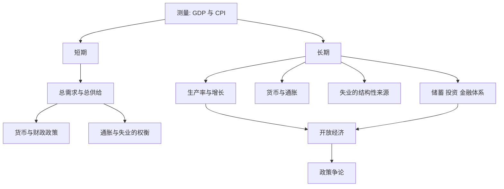

# 曼昆《经济学原理（第 7 版）》宏观分册 点化学习系统

## 这本分册在讲什么
宏观经济学研究的是**加总之后的整体**：为什么有的国家富、为什么物价会涨、为什么会有失业、为什么经济会周期性地衰退。曼昆的写法是先把"测量"立住（GDP 与物价），再按时间尺度分开：长期由生产率与货币决定，短期由总需求与总供给决定。

主线一句话：**长期看生产能力，短期看需求管理**。把这句话记住，宏观里几乎所有"这个政策有没有用"的问题都能先定位到正确的时间尺度上。

## 全书心智模型

看图说明：顶部是测量，中间分长期与短期两条线，底部在"政策争论"处汇合。注意第 31–32 章的开放经济同时属于长期（储蓄投资）与短期（汇率波动），是两条线的交叉点。

## 学习路径（推荐顺序）

| 步骤 | 章节 | 主题 | 前置 | 检查点 |
|---|---|---|---|---|
| 01 | ch23–ch24 | 测量：GDP、CPI、实际与名义 | 无 | 能算平减指数、通胀率、实际利率 |
| 02 | ch25 | 长期增长与生产率 | 01 | 能用 70 法则与四项因素解释增长差异 |
| 03 | ch26–ch27 | 储蓄投资、金融体系、金融工具 | 01 | 能画可贷资金市场、算现值 |
| 04 | ch28 | 失业的结构与政策 | 02 | 能区分三类失业并给出对策 |
| 05 | ch29–ch30 | 货币、银行、通胀 | 03 | 能算货币乘数、用 MV = PY 解释通胀 |
| 06 | ch31–ch32 | 开放经济 | 03、05 | 能用 NX = S − I 与两市场模型推演政策 |
| 07 | ch33–ch34 | AD-AS 与政策工具 | 05 | 能画需求冲击的短期与长期结果、算乘数 |
| 08 | ch35–ch36 | 通胀—失业权衡与六大争论 | 07 | 能解释长期曲线为何垂直、说出六场争论的正反方 |

## 章节索引
- 第 23 章 一国收入的衡量（★★☆）→ chapters/ch23-一国收入的衡量.md
- 第 24 章 生活费用的衡量（★★☆）→ chapters/ch24-生活费用的衡量.md
- 第 25 章 生产与增长（★★☆）→ chapters/ch25-生产与增长.md
- 第 26 章 储蓄、投资和金融体系（★★★）→ chapters/ch26-储蓄投资和金融体系.md
- 第 27 章 金融学的基本工具（★★★）→ chapters/ch27-金融学的基本工具.md
- 第 28 章 失业（★★☆）→ chapters/ch28-失业.md
- 第 29 章 货币制度（★★★）→ chapters/ch29-货币制度.md
- 第 30 章 货币增长与通货膨胀（★★★）→ chapters/ch30-货币增长与通货膨胀.md
- 第 31 章 开放经济的基本概念（★★☆）→ chapters/ch31-开放经济的基本概念.md
- 第 32 章 开放经济的宏观经济理论（★★★）→ chapters/ch32-开放经济的宏观经济理论.md
- 第 33 章 总需求与总供给（★★★）→ chapters/ch33-总需求与总供给.md
- 第 34 章 货币政策和财政政策对总需求的影响（★★★）→ chapters/ch34-货币政策和财政政策对总需求的影响.md
- 第 35 章 通货膨胀与失业之间的短期权衡取舍（★★★）→ chapters/ch35-通货膨胀与失业之间的短期权衡取舍.md
- 第 36 章 宏观经济政策的六个争论问题（★★★）→ chapters/ch36-宏观经济政策的六个争论问题.md

## 前置知识（理工科本科缺口补讲）
| 缺口 | 对应补讲位置 | 学完标志 |
|---|---|---|
| 存量和流量的区分（工科习惯看"总量存量"） | ch23 | 能说清"当年新建"与"已有总量"的区别 |
| 指数的构造与基年 | ch24 | 能自己用一篮子商品算出 CPI |
| 实际与名义的区分 | ch24、ch30 | 能把名义工资换算成实际工资 |
| 复利与现值 | ch27 | 能用 PV = FV/(1+r)^n 比较项目 |
| 乘数收敛的等比数列 | ch34 | 能推出 1/(1−MPC) |
| 弹性与预期（用于政策分析） | ch33、ch35 | 能解释为什么预期会改变政策效果 |

## 术语表 / 模式库 / 速查表入口
- 术语：glossary.md
- 模式：patterns.md（长期/短期的双框架、政策推演四步、常见误判）
- 速查：cheatsheet.md（公式、定量示例、传导链速查）
- 概念页：concepts/（GDP 与增长、通胀、货币与银行、利率与可贷资金、AD-AS、菲利普斯曲线、开放经济）
- 测验：quiz.md；抽认卡：flashcards.md
