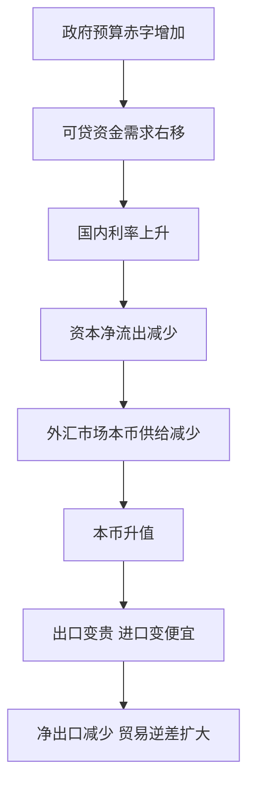

# 第 32 章：开放经济的宏观经济理论

- **难度**：★★★ | **预估学时**：2.5 小时 | **前置**：第 26、31 章

## 学习目标
学完本章，你能：
1. 用「可贷资金市场 + 外汇市场」两个市场解释汇率与资本流动如何同时均衡。
2. 推演预算赤字、贸易政策、资本外逃三类冲击的连锁反应。
3. 说明为什么贸易政策减少进口却不会改善贸易余额。

## 一句话核心
开放经济有两个联动的市场：国内利率由可贷资金市场决定，汇率由外汇市场决定，而连接两者的是资本净流出——利率一变，资本流动就变，汇率跟着变，净出口再被推着变。

## 零基础讲解

### 两个市场，一条链
**第一个市场：可贷资金市场。** 供给是国民储蓄，需求是投资加资本净流出（国内资金的两条去处：买本国设备，或买外国资产）。
- 利率是价格。利率越高，投资越少，资本净流出也越少（外国资产回报显得不划算）。

**第二个市场：外汇市场。** 供给是资本净流出（本国人要买外国资产，需要外币，于是抛本币），需求是外国人对本国商品与资产的需求（他们要买本国货，需要本币）。
- 汇率是价格。本币越贵，出口越贵、进口越便宜，净出口越少。

**连接链条**：
利率 → 资本净流出 → 外汇市场供求 → 汇率 → 净出口

这条链是本章所有推演的基础。记住方向：利率上升 → 资本净流出减少 → 本币需求减少（或供给增加）→ 本币贬值 → 出口变便宜 → 净出口增加。

等等，这里容易绕错，用一个标准推演验证：政府赤字。
1. 政府借得多了 → 可贷资金需求右移 → 利率上升。
2. 利率上升 → 资本净流出减少（本国资金更愿意留在国内）。
3. 资本净流出减少 → 外汇市场上本币供给减少 → 本币升值。
4. 本币升值 → 出口变贵、进口变便宜 → 净出口减少（贸易赤字扩大）。

这条链的结果是：赤字 → 利率升 → 本币升 → 贸易逆差扩大。美国 1980 年代的"双赤字"就是这一模式的经验版本。

看图说明：这条链有五个环节，任一环节断开，结论就不成立。比如经济处于深度衰退、利率已经接近零，赤字不会推高利率，链条第一步就断了，后面的升值与逆差也不会发生。

### 三类冲击

**一、贸易政策（关税、配额）。** 减少进口 → 外汇市场上对外币的需求减少 → 本币升值 → 出口减少。结果是：进口降了，出口也降了，**净出口总量基本不变**，贸易余额不改善，但贸易量萎缩、效率下降。

这个结论反直觉但对理解政策很有用：贸易政策改变的是"买谁的、卖什么"，而不是"总共买卖多少"。总量由储蓄与投资决定。

**二、资本外逃。** 投资者对本国失去信心，把资金转走。
1. 资本净流出增加 → 外汇市场本币供给增加 → 本币贬值。
2. 同时国内可贷资金供给减少 → 利率上升。
3. 贬值有利出口，净出口增加；利率上升抑制投资。

这是 1997 年亚洲金融危机、2018 年阿根廷比索危机的机制。

**三、储蓄率上升。** 供给右移 → 利率下降 → 资本净流出增加 → 本币贬值 → 净出口增加。贸易顺差扩大、国内投资可能增加。这是中国、德国长期顺差的解释之一。

### 一个必须记住的恒等式视角
NX = S − I。任何政策只要不改变 S 或 I，就无法改变 NX。

- 赤字：政府借走了 S，S 相对 I 减少 → NX 减少（逆差）。
- 贸易政策：不改变 S 与 I → NX 不变。
- 资本外逃：不改变 S 与 I（只改变资金去向）→ NX 不变，但汇率与利率变了。

这个视角比逐条推演链条更快，而且不容易绕错。

## 常见误解
- 别以为"限制进口能减少贸易逆差"——实际上只会让本币升值、出口同步下降，总量不变。
- 别以为"资本流入总是好事"——实际上它推高本币、打击出口，且随时可能逆转成资本外逃。
- 别以为"贸易逆差是失败"——实际上它意味着外国资金在为本国投资融资，问题在于这些资金是否用于有效投资。
- 别以为"汇率由央行决定"——实际上央行只能干预短期，长期由资本流动与物价决定。

1. （单选）政府预算赤字扩大，在开放经济中通常导致？
   A. 利率上升、本币升值、净出口减少  B. 利率下降、本币贬值、净出口增加  C. 利率不变、净出口不变  D. 利率上升、本币贬值
   **答案**：A；**解析**：赤字抬高利率，资本净流出减少，本币升值，出口变贵、进口变便宜，净出口减少，贸易逆差扩大。

2. （单选）限制进口的贸易政策对贸易余额的长期影响是？
   A. 显著改善贸易余额  B. 基本不改变贸易余额，只改变贸易构成与数量  C. 必然扩大逆差  D. 使本币贬值
   **答案**：B；**解析**：进口减少使本币升值、出口同步减少，NX = S − I 未变，因此总量不变，只改变贸易结构与规模。

3. （单选）资本外逃会带来？
   A. 本币升值、利率下降  B. 本币贬值、利率上升  C. 本币升值、利率上升  D. 本币贬值、利率下降
   **答案**：B；**解析**：资金流出使外汇市场本币供给增加、本币贬值；同时国内可贷资金减少，利率上升。

4. （多选）在开放经济两市场模型中，连接可贷资金市场与外汇市场的是？
   A. 资本净流出  B. 国内利率  C. 汇率  D. 政府税收
   **答案**：A、B；**解析**：利率决定资本净流出，资本净流出又进入外汇市场决定汇率，这条链连接两个市场。

## 复习锚点
- 两个市场联动：可贷资金定利率，外汇市场定汇率，中间连着资本净流出。
- 赤字链条：赤字 → 利率升 → 本币升 → 逆差扩大。
- NX = S − I 是判断任何政策效果的快捷键；贸易政策不改变总量。
