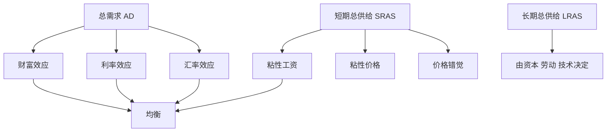

# 总需求与总供给

- **难度**：高难 | **涉及章节**：第 33、34、35 章

## 一句话定义
短期产量由需求决定、物价由供需交点决定；长期产量由资本、劳动、技术决定，需求只推高价格。

## 为什么重要
它是宏观分析的主模型：衰退、通胀、政策效果、菲利普斯曲线，全都从这张图推出来。把这张图吃透，第 34、35 章只是加了两组工具。

## 图示

看图说明：左边是三条曲线的成因，右边汇到一个均衡点。注意 LRAS 与 AD、SRAS 的性质完全不同——它画的是生产能力，不是价格反应。

## 详解
### AD 向下的三个渠道
1. **财富效应**：物价降 → 现金购买力升 → 消费增。
2. **利率效应**：物价降 → 货币需求降 → 利率降 → 投资增。
3. **汇率效应**：物价降 → 出口竞争力升 → 净出口增。

移动因素：C、I、G、NX 的外生变化。

### SRAS 向上的三个解释
粘性工资、粘性价格、价格错觉。共同点是"价格信号在短期内被误读或未调整"。

### LRAS 垂直
产量由要素与技术决定（自然产出率），与物价无关。移动因素：劳动人口、资本存量、技术进步、制度。

### 两类冲击
**需求冲击**：短期产量与物价同升，长期只涨价。
**供给冲击**：SRAS 左移，产量降、物价升——滞胀，政策两难。

### 政策连接
第 34 章讲怎么移动 AD（货币与财政），第 35 章讲移动之后的通胀—失业后果。三章是一个整体。

## 常见误解
- 别以为"AD 向下是因为东西便宜大家多买"——实际上是三个宏观渠道，与单品替代效应不同。
- 别以为"长期供给也能向上倾斜"——实际上价格不影响长期产量。
- 别以为"需求扩张能永久提高产量"——实际上长期回到自然率，只留下更高的价格。

## 在书中出现的脉络
| 章节 | 语境 | 关键结论 |
|---|---|---|
| 第 33 章 | AD-AS 模型 | 三事实、曲线成因、两类冲击 |
| 第 34 章 | 政策对 AD 的影响 | 流动性偏好、乘数、挤出效应 |
| 第 35 章 | 通胀与失业 | 菲利普斯曲线是同一模型的另一坐标 |
| 第 36 章 | 政策争论 | 稳定经济的时滞与不确定性 |

## 相关概念
- **通货膨胀**（需求与供给冲击的结果）
- **失业**（产量下降的直接后果）
- **菲利普斯曲线**（AD-AS 的另一种画法）
