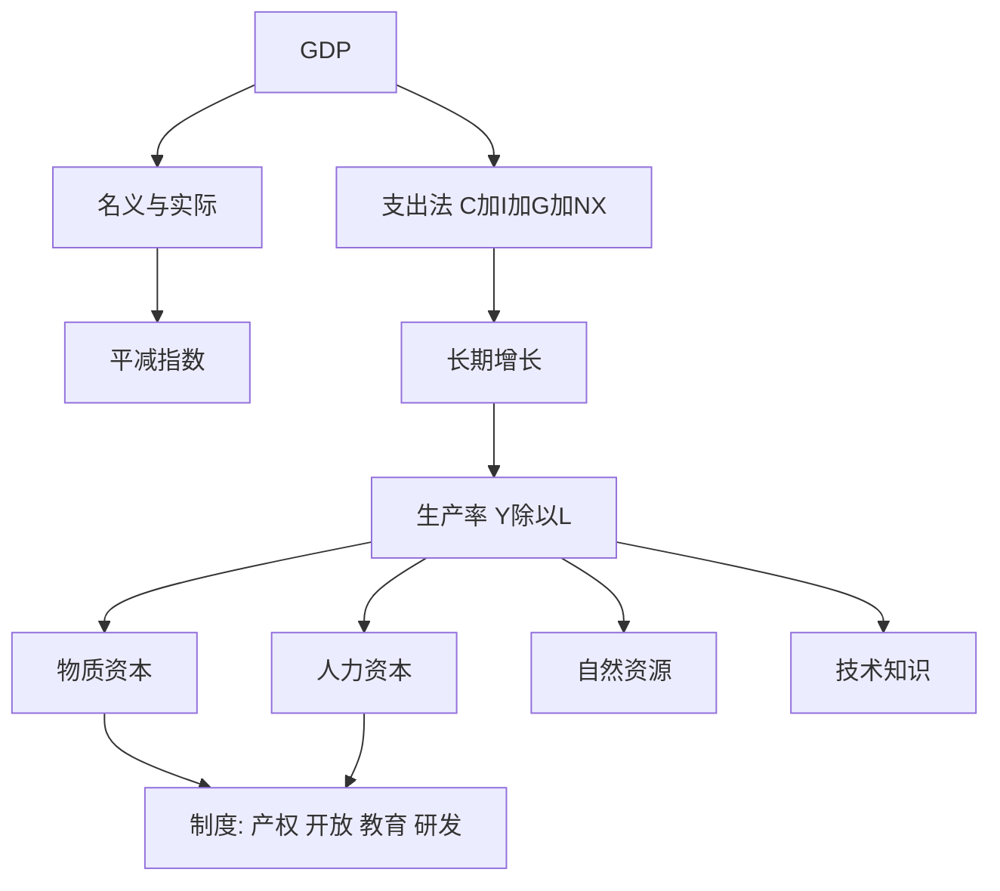

# GDP 与长期增长

- **难度**：基础 | **涉及章节**：第 23、25 章

## 一句话定义
GDP 是一国境内一年里新生产的所有最终产品与服务的市场价值；它的长期增长只取决于一件事——**生产率**，即每个劳动小时能产出多少东西。

## 为什么重要
它是宏观所有讨论的起点：增长、通胀、失业、政策，都要先有"产出"这个被测量的对象。理解 GDP 的定义边界，才知道它能回答什么、不能回答什么。

## 图示

看图说明：上半部分是"怎么算 GDP"，下半部分是"为什么会长"。两条线在"实际 GDP 增长"处汇合——这也是第 25 章的全部内容。

## 详解
### GDP 的边界
四个限定：境内、一定时期、最终产品、市场价值。因此不计入：二手交易（除佣金）、转移支付、家务与自给劳动、地下经济。

支出法：**GDP = C + I + G + NX**。进口已经算在 C 里但不是本国生产，所以要用 NX 减去。

### 名义与实际
名义 GDP 用当期价格，实际 GDP 用基年价格。平减指数 = 名义 ÷ 实际 × 100，它的变化率就是通胀率的近似。

### 长期增长
人均 GDP 的差距来自生产率。生产率由四项决定：物质资本、人力资本、自然资源、技术知识。

政策杠杆：储蓄与投资、吸引外资、教育健康、产权与政治稳定、自由贸易、研发。

**70 法则**：翻倍年数 ≈ 70 ÷ 增长率。2% 要 35 年，7% 只要 10 年——复利下差距惊人。

**追赶效应**：资本边际收益递减使穷国增长潜力更大，但需要制度条件配合。

## 常见误解
- 别以为"GDP 增长等于生活变好"——实际上要看人均实际 GDP，还要看分配与环境。
- 别以为"资源丰富必然富裕"——实际上制度与人力资本更关键。
- 别以为"增长率差几个点无所谓"——实际上几十年后是数量级的差距。

## 在书中出现的脉络
| 章节 | 语境 | 关键结论 |
|---|---|---|
| 第 23 章 | 一国收入的衡量 | GDP 定义、支出法、平减指数 |
| 第 24 章 | 生活费用 | 实际与名义的区分延伸到价格与利率 |
| 第 25 章 | 生产与增长 | 生产率的四项决定因素与增长政策 |
| 第 33 章 | AD-AS | 长期产量由自然产出率决定 |

## 相关概念
- **通货膨胀**（平减指数把名义与实际分开）
- **失业**（增长与就业的关系）
- **AD-AS**（长期增长的图形表达）
