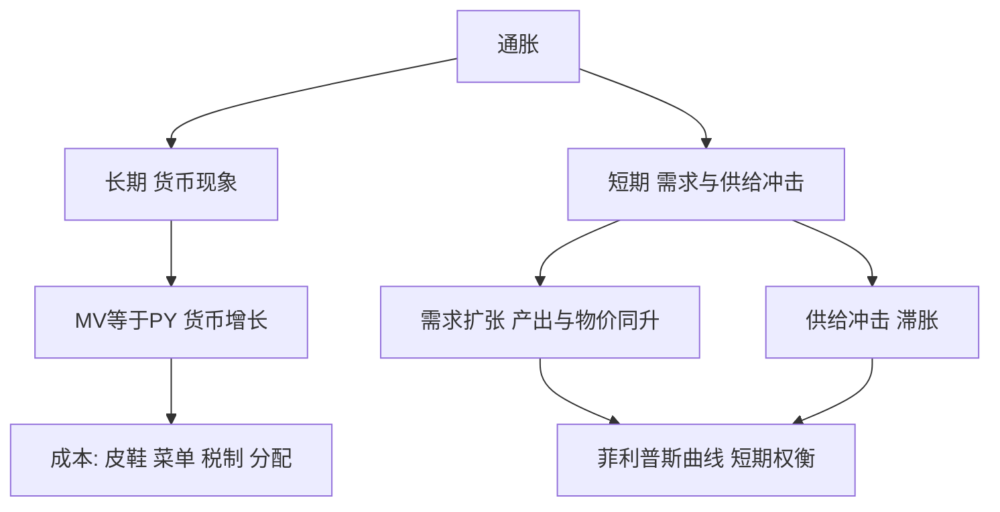

# 通货膨胀

- **难度**：进阶 | **涉及章节**：第 24、29、30、35 章

## 一句话定义
通货膨胀是物价水平的普遍、持续上涨，等价于货币购买力的下降；长期由货币增长决定，短期由总需求与供给的失衡推动。

## 为什么重要
它同时是"指标""成本"和"政策目标"：衡量要用 CPI，理解成因要用货币数量论，应对要用菲利普斯曲线，定目标要用第 36 章的争论。四个章节围绕一个词展开。

## 图示

看图说明：同一个现象有两套解释框架，长期用货币数量论，短期用 AD-AS 与菲利普斯曲线。两套框架不矛盾，只是时间尺度不同。

## 详解
### 衡量
CPI 用固定篮子算，偏高（替代偏差、新产品、质量变化）。GDP 平减指数覆盖全部国内生产。通胀率 = 指数变化率。

### 长期：货币数量论
MV = PY。V 稳定、Y 由技术决定，所以 P 随 M 走。"通胀在任何地方都是货币现象"指的是这个。

**货币中性**：长期货币量只影响名义变量，不影响真实产出。**古典二分法**把名义变量与真实变量分开分析。

### 短期：需求与供给
需求扩张 → 沿 SRAS 上升 → 产量与物价同升。供给冲击 → SRAS 左移 → 滞胀。

### 成本
皮鞋成本、菜单成本、相对价格混乱、税制扭曲、财富再分配。注意"通胀让所有人变穷"是谬误——收入通常同步上涨。

### 与失业的短期权衡
第 35 章的菲利普斯曲线：短期通胀与失业可以互换，长期曲线垂直在自然失业率处。反通胀的代价用牺牲率衡量。

## 常见误解
- 别以为"通胀是坏事，所以零通胀最好"——实际上适度正通胀能避免通缩与工资调整困难。
- 别以为"债务人总是通胀的赢家"——实际上只有未预期部分才重新分配财富。
- 别以为"CPI 涨多少我的成本就涨多少"——实际上每个人的消费篮子不同。

## 在书中出现的脉络
| 章节 | 语境 | 关键结论 |
|---|---|---|
| 第 24 章 | 生活费用 | CPI、平减指数、实际利率 |
| 第 29 章 | 货币制度 | 货币供给的创造机制 |
| 第 30 章 | 货币增长与通胀 | 数量论、货币中性、五项成本、费雪效应 |
| 第 35 章 | 通胀与失业 | 短期权衡、长期垂直、牺牲率 |
| 第 36 章 | 政策争论 | 零通胀目标的正反双方 |

## 相关概念
- **GDP 与长期增长**（实际与名义的区分）
- **货币与银行**（通胀的源头）
- **菲利普斯曲线**（与失业的权衡）
