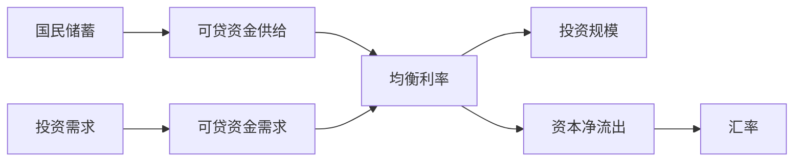

# 利率与可贷资金市场

- **难度**：进阶 | **涉及章节**：第 26、27、32 章

## 一句话定义
利率是"今天用钱的价格"：储蓄者出让资金要利息，投资者借入资金付利息，两者在可贷资金市场上相遇，共同决定利率。

## 为什么重要
利率是把"现在的消费"与"未来的投资"连接起来的价格。它在国内决定投资规模（第 26 章）、在国际上决定资本流动方向（第 32 章）、在金融资产上决定债券与股票的估值（第 27 章）。

## 图示

看图说明：左边两组力量决定利率；利率出去分两条路，一条管国内投资，一条管国际资本流动。这就是第 32 章两个市场的连接点。

## 详解
### 供给与需求
供给来自储蓄：S = Y − C − G。利率越高，储蓄意愿越强。
需求来自投资：机器、厂房、住宅。利率越高，项目越少。

均衡利率处，储蓄恰好等于投资（封闭经济）。

### 政策影响
- **储蓄激励**（免税账户）：供给右移，利率降、投资增。
- **投资激励**（税收抵免）：需求右移，利率升、投资增。
- **政府赤字**：需求右移，利率升，私人投资被**挤出**。

挤出效应的强弱取决于经济状态：衰退期资金闲置，挤出弱；繁荣期资金紧张，挤出强。

### 与货币政策的区别
可贷资金市场解释的是**长期实际利率**；央行的流动性偏好理论解释的是**短期名义利率**。两者不冲突：央行短期调利率，长期利率由储蓄与投资决定。

### 名义与实际
实际利率 ≈ 名义利率 − 通胀率。影响投资决策的是实际利率，因为企业算的是真实的回报。

## 常见误解
- 别以为"利率由央行单方面决定"——实际上央行只影响短期，长期由资金供求决定。
- 别以为"储蓄越多利率越低越好"——实际上低利率可能反映投资需求不足。
- 别以为"赤字必然抬高利率"——实际上衰退期挤出效应可能接近零。

## 在书中出现的脉络
| 章节 | 语境 | 关键结论 |
|---|---|---|
| 第 24 章 | 生活费用 | 名义与实际利率的换算 |
| 第 26 章 | 储蓄投资与金融体系 | 可贷资金市场与挤出效应 |
| 第 27 章 | 金融工具 | 利率作为贴现率决定现值 |
| 第 32 章 | 开放经济 | 利率影响资本净流出与汇率 |
| 第 34 章 | 货币政策 | 流动性偏好解释短期利率 |

## 相关概念
- **货币与银行**（短期利率的来源）
- **开放经济**（利率与汇率的联动）
- **GDP 与长期增长**（投资是增长的来源）
