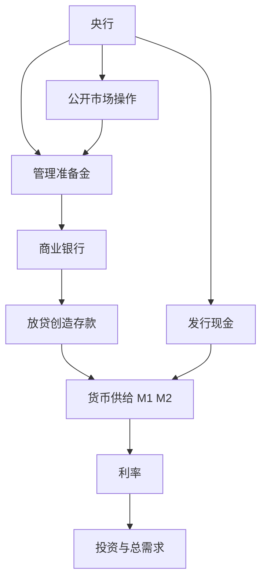

# 货币与银行体系

- **难度**：进阶 | **涉及章节**：第 29、30、34 章

## 一句话定义
货币是被广泛接受的交换媒介；现代货币由央行发行的现金与商业银行创造的存款共同构成，银行每放一笔贷款就多创造一笔存款。

## 为什么重要
它是货币政策的物理基础。不懂"存款是银行创造的"，就看不懂"央行买入债券为什么能增加货币供给"，也看不懂第 34 章的传导链。

## 图示

看图说明：上面是货币的"生产流程"——央行管基础，银行靠放贷放大；下面是货币进入实体经济的通道，通过利率影响投资。

## 详解
### 货币的三项职能
交换媒介、计价单位、价值储藏。**流动性**决定什么算 M1（现金加活期）与 M2（再加入定期与货基）。

### 银行如何创造货币
准备金率 10%，存入 1000 元 → 留 100 元、贷 900 元 → 900 元再存再贷……存款总额收敛到 1000 ÷ 0.1 = 10000 元。

**货币乘数 = 1 ÷ 准备金率**。现实中更小，因为现金漏出、银行持超额准备金。

### 央行的三种工具
1. **公开市场操作**：买卖政府债券，最常用、最灵活。
2. **准备金率**：作用猛烈，很少动用。
3. **利率**：通过政策利率与利率走廊引导市场利率。

现实中央行设定**目标利率**而非目标货币量，因为货币量难以精确控制。

### 与通胀、总需求的连接
货币增长超过产出增长 → 通胀（第 30 章）。货币供给增加 → 利率下降 → 投资增加 → 总需求右移（第 34 章）。

## 常见误解
- 别以为"只有央行能创造货币"——实际上商业银行通过放贷创造存款。
- 别以为"存款是银行替你保管的钱"——实际上它是对银行的债权，银行把它贷出去生息。
- 别以为"央行能精确控制货币量"——实际上乘数会变，央行更多通过利率间接调控。

## 在书中出现的脉络
| 章节 | 语境 | 关键结论 |
|---|---|---|
| 第 29 章 | 货币制度 | 职能、类型、乘数、三大工具 |
| 第 30 章 | 货币增长与通胀 | 货币量与物价的长期关系 |
| 第 34 章 | 货币政策与总需求 | 流动性偏好与传导链 |
| 第 36 章 | 政策争论 | 规则还是相机抉择 |

## 相关概念
- **通货膨胀**（货币增长的后果）
- **利率与可贷资金**（货币市场与资金市场的关系）
- **AD-AS**（货币政策的最终作用点）
