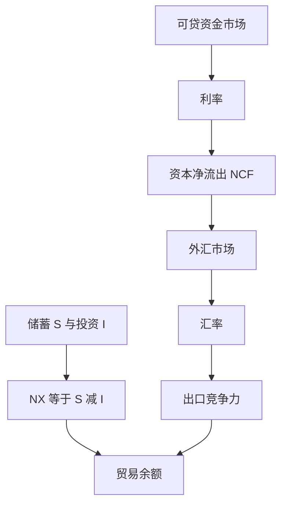

# 开放经济

- **难度**：高难 | **涉及章节**：第 31、32 章

## 一句话定义
一个开放经济里，贸易余额与资本流动是同一枚硬币的两面（NX = NCF），汇率则是把这两个市场连起来的转换器。

## 为什么重要
它把前面所有工具放到国际场景：储蓄与投资决定贸易余额，利率决定资本流向，汇率再决定出口竞争力。理解这套联动，才能判断"关税能不能减少逆差""资本外逃会发生什么"。

## 图示

看图说明：这张图是循环的——贸易余额由储蓄投资决定，资本流动由利率决定，汇率又把资本流动与出口连回去。四个环节缺一不可。

## 详解
### 恒等式
NX = NCF；由 S = I + NX 得 **NX = S − I**。

顺差 = 储蓄超过投资 = 资金借给外国（资本净流出）。
逆差 = 投资超过储蓄 = 靠外国资金补足（资本净流入）。

### 汇率
名义汇率：两种货币的兑换比率。
实际汇率 = 名义汇率 × 国内物价 ÷ 国外物价，衡量本国商品的相对价格。

### 购买力平价
同种商品在各国换算后应同价，靠套利实现。局限：服务不可贸易、存在壁垒、消费篮子不同。长期部分成立，短期基本无效。

### 政策推演
- **赤字**：利率升 → 资本净流出减少 → 本币升值 → 逆差扩大。
- **贸易政策**：进口减少 → 本币升值 → 出口减少 → NX 不变，只改变构成。
- **资本外逃**：本币贬值 + 利率上升。

判断任何政策对 NX 的影响，最快的办法是看它是否改变 S 或 I。

## 常见误解
- 别以为"限制进口能减少逆差"——实际上只会让本币升值、出口同减。
- 别以为"顺差是胜利"——实际上它意味着国内消费与投资相对不足。
- 别以为"汇率越低越有利"——实际上它有利出口、不利进口与消费者。

## 在书中出现的脉络
| 章节 | 语境 | 关键结论 |
|---|---|---|
| 第 31 章 | 基本概念 | NX = NCF、储蓄投资关系、实际汇率、PPP |
| 第 32 章 | 开放经济理论 | 两个市场联动、三类冲击的推演 |
| 第 26 章 | 可贷资金市场 | 利率的国内来源 |
| 第 9 章（微观） | 国际贸易 | 进出口对国内剩余的影响 |

## 相关概念
- **利率与可贷资金**（资本流动的驱动）
- **GDP 与长期增长**（储蓄率与投资）
- **通货膨胀**（影响实际汇率与竞争力）
