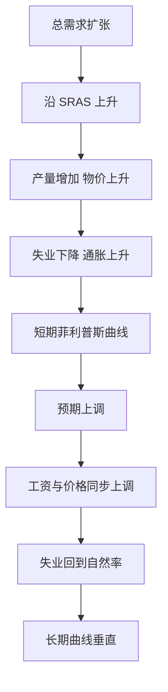

# 菲利普斯曲线

- **难度**：高难 | **涉及章节**：第 35、36 章

## 一句话定义
菲利普斯曲线画的是通胀率与失业率的关系：短期二者此消彼长，长期是一条垂直线——失业回到自然率，通胀高低由政策决定。

## 为什么重要
它是"政策能做什么、不能做什么"的分界线。短期可以交换，长期不能；预期到的通胀无效，意外的通胀才有用。这一条支撑了第 36 章关于央行独立性与规则的全部争论。

## 图示

看图说明：从需求扩张出发，绕一圈回到"失业没变、只剩更高通胀"。这条路径就是 1970 年代滞胀打破旧观念的过程。

## 详解
### 短期
通胀与失业反向。机制：扩张需求 → 增产增雇 → 失业降、物价升。这是意料之外的通胀，企业来不及调整价格与工资。

### 长期
预期完全调整后，实际通胀等于预期通胀，产量回到自然率，失业不变。长期曲线垂直。

**自然率假说**：无论通胀多高，失业最终回到自然率。1970 年代通胀与失业同时上升，是这个假说的经验证据。

### 移动
- 预期上升 → 短期曲线整体上移。
- 供给冲击 → 曲线右移（更糟位置，滞胀）。
- 自然失业率变化（人口、最低工资、工会、失业保险）→ 长期曲线左右移动。

### 反通胀代价
**牺牲率**：降 1 个百分点通胀所损失的年度产出百分比，经验值约 2–5。

理性预期观点认为：央行若可信地宣布并能做到，预期立即下调，代价很小。沃尔克的实践（1979–1982）表明代价真实存在，格林斯潘时期的小幅调整表明可信度能降低成本。

## 常见误解
- 别以为"通胀与失业可以长期互换"——实际上长期只能决定通胀，不能决定失业。
- 别以为"降低通胀没有代价"——实际上除非预期瞬间调整，否则要经历产量损失。
- 别以为"菲利普斯曲线是新理论"——实际上它就是 AD-AS 换个坐标。

## 在书中出现的脉络
| 章节 | 语境 | 关键结论 |
|---|---|---|
| 第 33 章 | AD-AS | 需求扩张的短期与长期结果 |
| 第 35 章 | 短期权衡 | 曲线由来、预期作用、供给冲击、牺牲率 |
| 第 36 章 | 政策争论 | 零通胀目标、规则与相机抉择 |

## 相关概念
- **AD-AS**（同一模型的另一种表达）
- **通货膨胀**（曲线的纵轴）
- **失业**（曲线的横轴，长期锚定在自然率）
